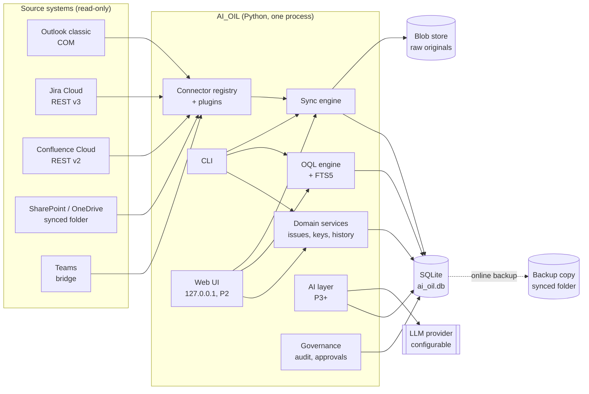
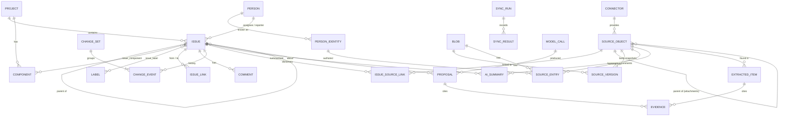
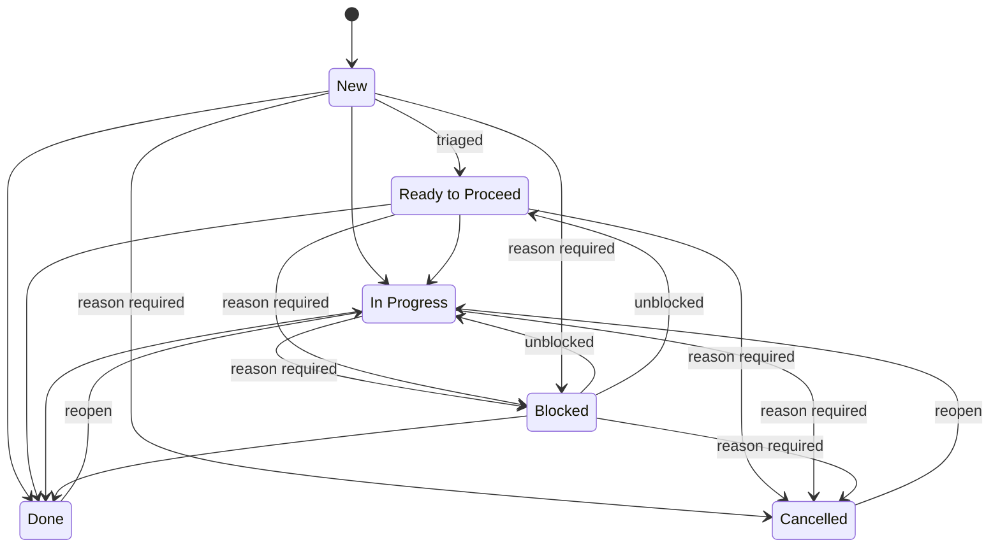

# AI_OIL — Specification

## An AI-assisted open issue list that pulls its own information

| | |
|---|---|
| **Version** | 0.5 — phases 1 and 2 implemented |
| **Date** | 28 October 2026 |
| **Owner** | Alex Hultsch |
| **Basis** | Requirements interview of 26 October 2026 (Appendix A); implementation decisions of 27 October 2026 (Appendix C) |
| **Executable data model** | [`src/ai_oil/db/sql/0001_baseline.sql`](../src/ai_oil/db/sql/0001_baseline.sql) — authoritative where it and chapter 5 differ |

---

## 0. How to read this document

Chapter 1 explains what the product is for, and chapter 2 explains the order in which it is built. **Chapter 5, the data model, is the part to review first.** Phase 1 builds it, and everything else depends on it. Chapters 6–8 describe how data gets into the model and how it is searched. Chapters 9–12 describe the later phases at a level that is detailed enough to check that the data model covers them, without fixing their design yet.

Every requirement has an ID such as `DM-12`. Code, commits and tests refer to these IDs.

| Prefix | Area |
|---|---|
| `OBJ` | Objectives |
| `AP` | Architecture principles |
| `DM` | Data model |
| `CON` | Connectors |
| `SYNC` | Synchronisation |
| `SRCH` | Search and query language |
| `CLI` | Command line (phase 1) |
| `UI` | Web interface (phase 2) |
| `AI` | AI enrichment (phase 3) |
| `AST` | AI assistant (phase 4) |
| `WB` | Dashboards (phase 5); write-back dropped (OP-47) |
| `GOV` | Governance |
| `NFR` | Non-functional requirements |

---

## 1. Objectives

### 1.1 The problem

A topic rarely lives in one place. A supplier problem has a Jira ticket. The real discussion happens in an email thread with five people. The decision is recorded on a Confluence page. The latest numbers are in an Excel file on SharePoint, and an agreement from a phone call exists only in someone's head. Classic issue trackers like Jira hold one of these pieces. Following up means opening all of them, remembering which emails belong to which topic, and noticing who is still waiting for an answer.

### 1.2 The idea

AI_OIL is a deliberately simplified Jira. **Each issue carries a dictionary of linked sources**: email conversations, Jira tickets, Confluence pages, SharePoint files and manual notes. The system visits every linked source, fetches the latest state and stores it in the issue, with versions, so that one place holds everything that is known about a topic. On that base, the AI later summarises, extracts actions and open questions, suggests new links and new issues, and reminds the user what to do and whom to answer.

### 1.3 Success criteria

| ID | Criterion |
|---|---|
| OBJ-1 | Any issue can be linked to any number of sources of any supported type, and one source can be linked to several issues |
| OBJ-2 | One command (later one button) refreshes all sources of an issue, or all issues. Every change in a source becomes a stored, dated version or entry |
| OBJ-3 | The full content of an issue, its comments and all linked source content can be searched from one query |
| OBJ-4 | Every change to an issue is visible in its history: who or what changed which field, from which value, to which value, and when |
| OBJ-5 | A new source type can be added as a plugin without changing the data model |
| OBJ-6 | From phase 3, nothing the AI produces changes an issue without the user's approval of that individual item |
| OBJ-7 | From phase 4, the user sees one list of everything that waits on them across email, Jira and the issue list |

### 1.4 Out of scope (for all phases unless reopened)

- Multi-user operation, permissions, SSO. The product is for **one user** on one laptop. The data model does not block a later team version, but no phase builds one.
- Mobile use.
- Background polling, schedulers and daemons (AP-2).
- Mirroring Jira completely. Jira tickets are *sources*, not the system of record for AI_OIL issues.
- Custom fields per project (deferred; see OI-6).
- Any code shared with the Professional-Assistant repository. AI_OIL is an independent product. Professional-Assistant's verified access paths (Outlook COM, Atlassian REST with a personal token, SharePoint through the sync client, a Teams bridge) are adopted as **design guidance only**.

---

## 2. Phases

| Phase | Name | Content | LLM calls |
|---|---|---|---|
| **P1** | Data foundation | SQLite schema, domain services (issues, keys, history), connector framework, connectors in the order Manual → Outlook → Jira → Confluence → SharePoint, on-demand sync, full-text index, OQL query engine, CLI, backup | **none** |
| **P2** | Web interface | Jira-like local web app: issue navigator with OQL and saved filters, issue detail page, inline edits, comments, history, source panel with refresh and version diff | none |
| **P3** | AI enrichment | LLM provider abstraction, summaries per source and per issue, extraction of action items, open questions, decisions and risks, link suggestions, import inbox for new issues, field-change proposals, proposal review UI | yes |
| **P4** | AI assistant | "My Inbox" (waiting on me, due, overdue, blocked, stale), daily briefing, unlinked-email detection, Jira mentions and assignments | yes |
| **P5** | Dashboards | Dashboards (server-side SVG). No write-back to external systems in any phase (decided 28 October 2026, OP-47) | no |

**Exit criteria**

| Phase | Done when |
|---|---|
| P1 | On the target laptop: create 20 real issues through the CLI, link at least one source of each of the five types, run `oil sync --all` twice with a real change in between, see the new version or entry stored and found by `oil search`, and see history entries for every field changed |
| P2 | All P1 operations are possible in the browser. P1 acceptance repeated without the CLI |
| P3 | For 20 real issues: the summary is correct in the user's judgement, every AI item shows its evidence, and no field was changed without approval |
| P4 | For two weeks of real use, the morning briefing and "My Inbox" contain no item the user considers wrong more than once a day |
| P5 | The dashboard gadgets of WB-4 are drawn from saved filters on real data (decided 28 October 2026, OP-47) |

**P1 has no LLM calls.** It is independent of the open provider decision (OI-3) and can start immediately.

---

## 3. Architecture principles

| ID | Principle | Practical consequence |
|---|---|---|
| AP-1 | **Deterministic before AI** | Fetching, hashing, diffing, deduplication, date arithmetic, sorting, search and "did I reply?" are plain code. The LLM does language understanding, classification and text generation only |
| AP-2 | **Pull on demand** | No background polling, no scheduler. Every sync, scan and AI run starts from a user action (CLI command or button). The daily briefing is generated on demand only (decided 28 October 2026, OP-45) |
| AP-3 | **Store everything, versioned** | Each fetched state is kept as an immutable version or entry. Nothing fetched is ever overwritten. Storage is cheap; lost context is not |
| AP-4 | **Source-agnostic core** | The core knows four concepts only: *source object*, *version*, *entry* and *link*. Everything source-specific lives in a connector plugin |
| AP-5 | **Propose, do not execute** | AI output is either a clearly labelled AI artefact (summary, extracted item) or a proposal. Official issue fields change only when the user accepts a proposal |
| AP-6 | **Evidence traceability** | Every AI artefact and proposal points to the exact source versions or entries it was derived from |
| AP-7 | **Delta processing** | AI runs only on content that is new since the last run (tracked per source object), never on the whole corpus |
| AP-8 | **Encapsulated AI layer** | Provider and model are configuration, not code |
| AP-9 | **Local first** | All data lives on the laptop, and nothing leaves it except calls to the configured LLM provider (P3+) and reads from the source systems |
| AP-10 | **Errors are reported, never swallowed** | A sync with an unreachable source finishes as `partial` and names the source. The UI shows a stale-data marker on that source |

---

## 4. System overview

### 4.1 Components



### 4.2 Runtime environment

| Item | Decision |
|---|---|
| OS | Windows 10/11 corporate laptop |
| Language | Python 3.12 |
| Libraries | SQLAlchemy 2 (core), Alembic (migrations), FastAPI + Jinja2 + HTMX (P2, so no npm or build step), `keyring` (Windows Credential Manager), `pywin32` (Outlook COM), `requests`, `python-docx`, `openpyxl`, `python-pptx`, `pypdf`, `beautifulsoup4` |
| Outlook | Classic desktop client is a prerequisite. The "new Outlook" has no COM interface |
| Atlassian | Jira Cloud and Confluence Cloud with a personal API token |
| SharePoint / OneDrive | Read from the locally synced folder; no Graph API, so no IT app registration is needed |

### 4.3 Storage locations

| What | Where | Why |
|---|---|---|
| Database | `%LOCALAPPDATA%\AI_OIL\ai_oil.db` (WAL mode) | **Not** inside any OneDrive/SharePoint sync root. A live SQLite file under a sync client is a known corruption source |
| Raw originals | `%LOCALAPPDATA%\AI_OIL\blobs\<aa>\<sha256>.gz` | Content-addressed, so identical attachments are stored once |
| Configuration | `%LOCALAPPDATA%\AI_OIL\config.toml` | Paths and settings only, never secrets |
| Secrets | Windows Credential Manager | Atlassian token and, later, the LLM key |
| Logs | `%LOCALAPPDATA%\AI_OIL\logs\` | Rotating, no content bodies, no secrets |
| Backup | A configured folder, typically inside a synced OneDrive library | A *closed* copy made with SQLite's online-backup API is safe to sync (NFR-8) |

---

## 5. Data model

### 5.1 Overview

The model has three layers:

1. **Work layer.** This is what the user manages: `project`, `issue`, `comment`, `issue_link`, `label`, `component`, `person`, and the append-only history (`change_set`, `change_event`).
2. **Source layer.** This is what the system collects: `connector`, `source_object`, `source_version`, `source_entry` and `blob`. `issue_source_link` connects the two layers and forms each issue's dictionary of sources.
3. **AI and governance layer.** This is what the AI derives (`ai_summary`, `extracted_item`, `proposal`, `evidence`, `model_call`, `briefing`) and how actions are controlled (`audit_log`, `approval`).



### 5.2 Key design decisions

| Decision | Chosen | Rejected alternative and why |
|---|---|---|
| Database | SQLite in WAL mode, outside the sync tree | JSON files (no transactions, no FTS, slow with thousands of versions); PostgreSQL (needs an installation on a corporate laptop) |
| Linking unit for email | The **conversation** (thread). New replies are picked up automatically | Single message (misses every later reply) |
| Fetched content | **Full normalised text for every version**, plus raw originals where the home system may lose them (email attachments) | Summary only (loses detail that the AI needs later); latest only (loses "what changed") |
| Mutable vs append-only content | **Two tables**: `source_version` for bodies that change (page, file, Jira fields) and `source_entry` for items that are added (messages, comments, changelog) | One generic table (forces a re-snapshot of a 40-message thread every time one reply arrives) |
| Version deduplication | New version only when the normalised content hash differs from the latest version | Store on every fetch (fills the database with identical copies) |
| Identity of people | `person` with several `person_identity` rows | Plain names (cross-source matching becomes impossible) |
| AI changes | Separate AI tables plus `proposal` with per-item approval | AI writes fields directly (violates AP-5) |
| History | Append-only `change_set` + `change_event`, enforced by triggers | Snapshot copies of the issue (hard to read, hard to diff) |
| Primary keys | Integer surrogate keys internally; the human key `PRJ-123` is a unique, immutable attribute | Key as primary key (makes a later key change or project move impossible) |
| Enumerations | `CHECK` constraints in the schema, mirrored as Python enums | Free text (invalid values creep in) |

### 5.3 People

| ID | Requirement |
|---|---|
| DM-20 | A `person` is any human the system knows: the user, colleagues, suppliers and customers. Exactly one person has `is_me = 1` |
| DM-21 | A `person_identity` is one way the person appears in a system: `email` (lower-case SMTP address), `atlassian` (accountId, shared by Jira and Confluence Cloud) or `teams`. `(system, external_id)` is unique |
| DM-22 | When the sync engine meets an unknown identity, it creates a person with that identity automatically (actor `sync`). Exchange-internal addresses (`/o=ExchangeLabs/...`) are resolved to SMTP before matching |
| DM-23 | Two persons that turn out to be the same are merged: `merged_into_id` points at the survivor and all references are re-pointed. Merging is a user action and is recorded in history. Assigning an issue to a merged person, or setting the reporter or any other person reference to one, is redirected to the surviving person, following the merge chain (decided 28 October 2026, OP-31) |

**`person`**

| Field | Type | Rule |
|---|---|---|
| `id` | int | PK |
| `display_name` | text | mandatory |
| `organisation` | text | optional, e.g. a supplier name |
| `is_me` | bool | exactly one row is 1 |
| `merged_into_id` | → person | set when merged |
| `notes` | text | optional |

**`person_identity`**: `person_id`, `system`, `external_id`, `display_name` (as last seen).

### 5.4 Projects, components, labels

| ID | Requirement |
|---|---|
| DM-1 | A `project` has a unique key of 2–10 characters (`[A-Z][A-Z0-9]*`), a name, an optional description and lead, and an `archived` flag. The key cannot be changed once an issue exists. Archiving is refused while any issue of the project is not Done or Cancelled; the error lists those issue keys. An archived project accepts no new issues, and its existing issues stay editable and can be reopened (decided 28 October 2026, OP-30) |
| DM-2 | `project.next_number` is the high-water mark of issue numbers. Numbers are allocated inside the issue-creation transaction and are never reused, not even after deletion |
| DM-3 | A `component` belongs to one project and is a fixed topic area within it. An issue can have several components of its own project |
| DM-4 | A `label` is a global, case-insensitive tag without spaces or commas. An issue can have any number of labels |

### 5.5 Issue

| ID | Requirement |
|---|---|
| DM-5 | Every issue belongs to exactly one project and has a key `<PROJECT>-<number>`, e.g. `OIL-42` |
| DM-6 | Key, number and project are immutable (enforced by trigger). Moving an issue to another project is not supported in v1; the workaround is to clone it, add a `duplicates` link, and cancel the original with the reason "Moved to <new key>" |
| DM-7 | `summary` (≤ 120 characters) and `description` are mandatory. The summary is action-oriented, and the description gives the context |
| DM-8 | Status values and transitions follow 5.6 |
| DM-9 | `cancel_reason` is mandatory while `status = Cancelled` (enforced by CHECK) |
| DM-10 | `blocked_reason` is mandatory while `status = Blocked` (enforced by CHECK) |
| DM-11 | Priority is `P1`–`P5` (5.7), default `P4` |
| DM-12 | `original_due_date` is set together with the first due date and is never changed afterwards (enforced by trigger). `revised_due_date` is the date that counts, and every change to it is recorded in history. Both are empty, or both are set |
| DM-13 | `origin_type` records where the issue came from: `manual`, `email`, `jira`, `confluence`, `sharepoint`, `teams` or `meeting`. If the origin is a source object, that object is also linked with role `origin` (5.11.6) |
| DM-14 | Issues can be linked by type: `relates_to` (symmetric, stored once with the lower id first), `blocks` (shown on the other side as *is blocked by*) and `duplicates` (shown as *is duplicated by*) |
| DM-15 | Hierarchy: `Epic` → `Task` → `Sub-task`. A Sub-task must have a parent of type Task. A Task may have an Epic as parent. An Epic has no parent. The depth is enforced in the domain service |

**`issue` fields**

| Field | Type | Mandatory | Owner | Rule |
|---|---|---|---|---|
| `id` | int | auto | system | Internal PK |
| `project_id` | → project | yes | user | Immutable |
| `number` | int | auto | system | From `project.next_number` |
| `key` | text | auto | system | `PRJ-123`, unique, immutable |
| `issue_type` | enum | yes | user | `Epic` · `Task` (default) · `Sub-task` |
| `parent_id` | → issue | no | user | See DM-15 |
| `summary` | text ≤ 120 | yes | user | Topic in one line |
| `description` | text (Markdown) | yes | user | What and why, with context |
| `acceptance_criteria` | text | no | user | How you know it is done. Basis for the AI progress check in P3 |
| `status` | enum | yes | user | 5.6 |
| `cancel_reason` | text | when Cancelled | user | Why the issue is not pursued |
| `blocked_reason` | text | when Blocked | user | What or whom it waits for |
| `priority` | enum | yes | user | `P1`–`P5` |
| `assignee_id` | → person | no | user | Anyone, including external people |
| `reporter_id` | → person | yes | user | Defaults to me |
| `original_due_date` | date | no | system | Frozen at first due date |
| `revised_due_date` | date | no | user | The date that counts |
| `origin_type` | enum | yes | system | Where the issue came from |
| `snoozed_until` | date | no | user | P4: hidden from My Inbox until then (AST-10) |
| `created_at`, `updated_at`, `resolved_at` | timestamp | auto | system | |
| labels, components | many-to-many | no | user | 5.4 |

### 5.6 Status workflow



| Status | Meaning | Category |
|---|---|---|
| `New` | Created, not yet triaged | To Do |
| `Ready to Proceed` | Triaged and clear, but work has not started | To Do |
| `In Progress` | Actively worked on | In Progress |
| `Blocked` | Waits on a person or dependency; `blocked_reason` is mandatory | In Progress |
| `Done` | Finished | Done |
| `Cancelled` | Not pursued; `cancel_reason` is mandatory. A duplicate is cancelled with a `duplicates` link to the surviving issue | Done |

| ID | Requirement |
|---|---|
| DM-16 | Transitions not shown in the diagram are rejected by the domain service |
| DM-17 | `resolved_at` is set when the status becomes Done or Cancelled. Reopening (Done/Cancelled → In Progress) clears `resolved_at` and `cancel_reason`; leaving Blocked clears `blocked_reason`. Every cleared value is recorded in history |
| DM-18 | `statusCategory` (To Do / In Progress / Done) is derived from the status and is not stored. It is available in OQL |

### 5.7 Priority

| Value | Meaning | Attention threshold (P4 assistant) |
|---|---|---|
| `P1` | Blocker: stops other work | 1 working day without activity |
| `P2` | Critical: schedule-, gate- or customer-relevant | 2 working days |
| `P3` | High: important, fixed due date | 3 working days |
| `P4` | Normal: routine (default) | 4 working days |
| `P5` | Backlog: no deadline pressure | 5 working days |

The number doubles as the threshold, in working days (Mon–Fri), after which an issue with no activity is flagged as stale by the assistant (AST-5). This needs no lookup table.

### 5.8 Comments

| ID | Requirement |
|---|---|
| DM-19 | A comment has an author (a person), a Markdown body and timestamps. Editing sets `edited_at`; deleting sets `deleted_at` (soft delete). Creating, editing and deleting are all recorded in history with the old text |

AI_OIL comments are the user's own notes on an issue. Comments in Jira or Confluence, and email messages, are **source entries** (5.11). They are shown in the same activity timeline but stored separately, because they belong to another system.

### 5.9 History

| ID | Requirement |
|---|---|
| DM-30 | Every create, update or delete of an issue field, label, component, comment, issue link or source link writes one `change_event` per field, grouped by one `change_set` per save |
| DM-31 | `change_set` and `change_event` are append-only (UPDATE and DELETE are rejected by triggers) |
| DM-32 | `change_set.actor_type` is `user`, `sync` or `system`. A change caused by an accepted AI proposal is a `user` change with `proposal_id` set, which shows "accepted AI proposal #123" |
| DM-33 | Values are stored raw (ids, codes, text). Display names are resolved when shown, so a renamed person shows correctly in old entries |

### 5.10 Example: one issue as its dictionary

This is what the user means by "all the information altogether like a dictionary". It shows how one issue reads once its links are resolved. The JSON is a view, not a storage format:

```json
{
  "key": "OIL-42",
  "summary": "Clarify inductor lead time for B-sample build",
  "status": "Blocked",
  "blocked_reason": "Waiting for supplier commitment on 26-week lead time",
  "priority": "P2",
  "assignee": "Alex Hultsch",
  "revised_due_date": "2026-11-15",
  "labels": ["supplier", "b-sample"],
  "sources": {
    "email": [
      { "title": "RE: Inductor L301 lead time", "messages": 14, "last_message": "2026-10-24T16:02Z", "last_from": "pm@acme.com" }
    ],
    "jira": [
      { "display_ref": "HWDEV-1187", "status": "In Progress", "versions": 6, "comments": 9 }
    ],
    "confluence": [
      { "title": "B-sample build plan", "version": 23 }
    ],
    "sharepoint": [
      { "title": "BOM_B-sample_v7.xlsx", "versions": 3, "last_changed": "2026-10-22T10:11Z" }
    ],
    "manual": [
      { "title": "Call with ACME purchasing 23 Oct", "type": "note" }
    ]
  }
}
```

### 5.11 Source layer

This is the core of the product. Four concepts carry every source type:

| Concept | Table | What it is | Example |
|---|---|---|---|
| **Source object** | `source_object` | A thing in another system that can be linked | An email conversation, a Jira issue, a page, a file |
| **Version** | `source_version` | An immutable snapshot of the object's *changing body* | Confluence page v23, the BOM file as of 22 Oct, Jira fields as of today |
| **Entry** | `source_entry` | An immutable item *added to* the object | One email message, one Jira comment, one changelog entry |
| **Link** | `issue_source_link` | "This object belongs to this issue" | OIL-42 ↔ thread "Inductor L301 lead time" |

#### 5.11.1 `connector`

| ID | Requirement |
|---|---|
| DM-40 | A `connector` row is one configured instance of a connector plugin (`type`) with a unique name, an `enabled` flag, non-secret `settings_json` (base URL, folders, sync roots) and a `credential_ref`, which is the *name* of a Windows Credential Manager entry and never the secret itself |
| DM-41 | Several instances of one type are allowed, for example two Jira sites or two mailboxes |

#### 5.11.2 `source_object`

| ID | Requirement |
|---|---|
| DM-42 | `external_id` is the **immutable** identifier in the home system: the Outlook `ConversationID`, the Jira numeric issue id (not the key, which changes when an issue moves), the Confluence page id, or the absolute local path for a synced file. `(connector_id, object_type, external_id)` is unique |
| DM-43 | `display_ref` is the human handle (Jira key, file name, subject). `locator` opens the object in its home system (URL or path) |
| DM-44 | `parent_id` makes children: an email attachment is a child of its thread, and a Jira attachment a child of its issue. **A link to a parent covers its children.** Children are never linked separately |
| DM-45 | `cursor` holds the connector's change marker: the last message time and anchor EntryID for email, `fields.updated` for Jira, `version.number` for Confluence, or `mtime` + sha256 for a file. The sync engine compares it before fetching content |
| DM-46 | `fetch_status` is `pending`, `ok`, `error` (with `fetch_error`), `gone` (deleted or no longer accessible in the source) or `skipped` (connector disabled). A `gone` object keeps all its stored versions |

`object_type` values: `email_thread`, `attachment`, `jira_issue`, `confluence_page`, `file`, `teams_thread` (planned before P3, OP-49), `note` (manual text), `web_link` (any URL, metadata only).

#### 5.11.3 `source_version`

| ID | Requirement |
|---|---|
| DM-47 | A version stores the **normalised plain text** (`text`) that search and AI read, plus `metadata_json` for structured attributes (e.g. the Jira status, assignee and labels at that time) and optionally a `blob_hash` for the raw original |
| DM-48 | A new version is written only when `content_hash` (sha256 over normalised text + significant metadata) differs from the **latest** version. A revert from A to B and back to A therefore creates three versions |
| DM-49 | `version_no` counts from 1 per object. `source_modified_at` is the home system's timestamp, and `fetched_at` is ours |

#### 5.11.4 `source_entry`

| ID | Requirement |
|---|---|
| DM-50 | An entry is an item that is appended to an object: `email_message`, `jira_comment`, `jira_change` (one changelog history item), `confluence_comment`, `teams_message` or `note_text`. `(source_object_id, entry_type, external_id, revision)` is unique |
| DM-51 | `external_id` is the Internet Message-ID for mail and the comment or changelog id for Atlassian. If the home system edits an entry (an edited Jira comment), a new row with `revision + 1` is written and the old one stays |
| DM-52 | `author_identity_id` points to a `person_identity`. `direction` is `out` when the author is me, which is the basis of every "did I reply?" check (AP-1). `recipients_json` lists the identity ids in To and Cc |
| DM-53 | For email, `text` is the full body as plain text, and `new_text` is the body without quoted history and signature (deterministic rules for English and German reply headers, e.g. `From:`/`Von:`, `-----Original Message-----`). Search indexes `new_text`, while AI reads `new_text` with the thread as context |

#### 5.11.5 `blob`

Raw originals are stored gzip-compressed under `blobs/<first two hex chars>/<sha256>.gz`, keyed by the hash of the raw bytes. Email attachments are always kept (up to `max_blob_mb`, default 25 MB), because the mail may be deleted or archived away. SharePoint files are **not** kept raw by default, because SharePoint has its own version history; only their extracted text is versioned (OI-8).

#### 5.11.6 `issue_source_link`

| ID | Requirement |
|---|---|
| DM-54 | The link is many-to-many: an issue has any number of sources, and one source can belong to several issues |
| DM-55 | `role` is `origin` (where the issue came from; at most one active per issue), `evidence` (where progress shows; used by the P3 progress check) or `reference` (context, the default) |
| DM-56 | `link_method` is `manual` or `ai_suggestion`. An AI link always references the accepted `proposal` (enforced by CHECK) |
| DM-57 | Unlinking sets `removed_at` and does not delete the row. Stored versions and entries remain. The same pair can be linked again later |
| DM-58 | Creating and removing links is recorded in issue history |
| DM-59 | An optional `note` explains why the source is relevant ("only the part about L301") |

#### 5.11.7 How each source type maps onto the model

| Source | `object_type` | `external_id` | Versions hold | Entries hold | Children | `cursor` |
|---|---|---|---|---|---|---|
| Outlook conversation | `email_thread` | ConversationID | *(none; a thread has no body of its own)* | One `email_message` per message, from all configured folders incl. Sent Items | `attachment` per attachment | Newest message time + anchor EntryID/StoreID |
| Email attachment | `attachment` | `<Internet Message-ID>#<position>` (identical bytes are stored once via the blob hash) | Extracted text (once) | — | — | hash |
| Jira issue | `jira_issue` | Jira issue id | Summary, description, status, assignee, priority, labels, fix versions, due date | `jira_comment` per comment, `jira_change` per changelog item | `attachment` (P1: metadata only) | `fields.updated` |
| Confluence page | `confluence_page` | Page id | Title + body (storage format → text) per page version | `confluence_comment` (footer and inline) | — | `version.number` |
| SharePoint / OneDrive file | `file` | Absolute local path | Extracted text per content change | — | — | mtime + sha256 |
| Manual note | `note` | Generated UUID | Note text; each edit is a version | — | — | hash |
| Web link | `web_link` | Normalised URL | *(none; metadata only)* | — | — | — |
| Teams chat (before P3, OP-49) | `teams_thread` | Chat/thread id | — | `teams_message` | — | last message time |

### 5.12 Sync runs

| ID | Requirement |
|---|---|
| SYNC-10 | Every sync writes one `sync_run` (trigger, scope, start, end, status `ok` / `partial` / `failed`, stats) and one `sync_result` per source object (outcome, number of new versions and entries, error, duration) |
| SYNC-11 | Every version and entry records the `sync_run_id` that produced it, so the UI can show "what changed in the last sync" |

### 5.13 AI layer (created in P3)

| Table | Purpose | Key rules |
|---|---|---|
| `model_call` | One row per LLM call: purpose, provider, model, prompt version, tokens, duration, status | AI-2 |
| `ai_summary` | Current and superseded summaries per source object and per issue | Only one current summary per scope. `basis_json` records the highest version and entry ids it covers, which drives delta processing (AP-7) |
| `extracted_item` | `action_item`, `open_question`, `decision` and `risk` found in sources | Has an owner person, `directed_at_me`, a due date and a state (`open`, `resolved`, `dismissed`, `superseded`). `resolved_by_entry_id` points to, e.g., my reply. `issue_id` may be empty for unlinked mail (AST-6) |
| `proposal` | Everything the AI wants to change: `new_issue`, `link_source`, `field_change`, `comment`, `external_action` (unused, OP-47) | Per-item decision (`accepted`, `accepted_edited`, `rejected`). A `dedup_key` stops a rejected proposal from coming back |
| `evidence` | Links any summary, extracted item or proposal to the exact version or entry, with an optional quote | Exactly one of version or entry per row |

### 5.14 Governance tables

| Table | Purpose |
|---|---|
| `audit_log` | Append-only (enforced by triggers). Every class B–E action (13.2), every source fetch, every model call and every proposal decision |
| `approval` (unused, OP-47) | Single-use token for a class C–E action, bound to class, target and a hash of exactly the payload that was shown |

### 5.15 Search tables

| Table | Purpose |
|---|---|
| `search_doc` | SQLite FTS5 index with one document per issue (summary + description + acceptance criteria), comment, **latest** version per source object, and latest revision per source entry. Maintained by SQLite triggers (migration 0002) in the same transaction as the row it mirrors |
| `saved_filter` | A named OQL query with its column set and a favourite flag |

### 5.16 Sizing

| Assumption (year 1) | Value |
|---|---|
| Issues | < 1,000 |
| Linked sources per issue | 5–20, many shared between issues |
| Average email thread | 15 messages × 5 KB text |
| Estimated database size | < 1 GB text |
| Estimated blob store | 2–10 GB (attachments); `max_blob_mb` and a total cap are configurable |

SQLite with FTS5 handles this comfortably. No partitioning or archiving is needed in any phase.

---

## 6. Connectors

### 6.1 Plugin contract

Connectors are Python plugins registered through a `ai_oil.connectors` entry point. The core never imports a connector directly. Adding a source type means adding a plugin and nothing else (OBJ-5).

```python
class Connector(Protocol):
    type: ClassVar[str]                    # 'outlook', 'jira', ...
    object_types: ClassVar[set[str]]       # what it can produce
    action_class: ClassVar[str] = "A"      # read-only in all phases (GOV-9, OP-47)

    def check(self) -> HealthReport: ...
    def parse_reference(self, text: str) -> SourceRef | None: ...
    def resolve(self, ref: SourceRef) -> ObjectMeta: ...
    def fetch(self, obj: ObjectState) -> FetchResult: ...
    def search_candidates(self, query: CandidateQuery) -> list[ObjectMeta]: ...
```

| Method | Does | Used by |
|---|---|---|
| `check` | Reachability, authentication, configured folders and paths | `oil connector check`, the UI status page |
| `parse_reference` | Turns user input (URL, key, path, subject) into a canonical reference, or returns `None` if it is not this connector's | The link dialog. All connectors are asked in turn |
| `resolve` | Confirms the object exists and returns its title, locator and external id | When linking |
| `fetch` | Returns everything new since `cursor`: a new version (if any), new or edited entries, child objects, the new cursor, or `gone` | The sync engine |
| `search_candidates` | Finds objects that are not yet linked, for link suggestions and the import scan | P3/P4 |

| ID | Requirement |
|---|---|
| CON-1 | Connectors are read-only in all phases (decided 28 October 2026, OP-47). Any write method must declare its action class and goes through governance (GOV-6) |
| CON-2 | Connectors return normalised data (plain text, UTC timestamps, identities as `(system, external_id)`). Hashing, versioning and storage are done by the sync engine, not the connector |
| CON-3 | A connector failure affects only its own objects (AP-10) |
| CON-4 | Connectors can be enabled and disabled individually in configuration and in the UI. A disabled connector's objects are reported as `skipped`, not as errors |
| CON-5 | A corporate CA bundle path is configurable for every HTTP connector (SSL inspection). Without one, the Jira and Confluence connectors trust the operating-system certificate store through `truststore`; the connector setting `use_system_certificates=false` switches that off |
| CON-6 | Every connector's system access (COM, HTTP, file system) sits behind a small injectable interface, so tests run against recorded fixtures. `oil connector check --live` runs a read-only check against the real system and is the acceptance test on the target laptop |

### 6.2 Manual connector (P1, built first)

| ID | Requirement |
|---|---|
| CON-10 | **Note:** free text (meeting minutes, phone call notes, pasted content) with a title. It is stored as a `note` object, and each edit becomes a new version. Notes are treated like any other source by search and AI |
| CON-11 | **Web link:** any URL that no other connector claims. Only metadata is stored (title, URL); no content is fetched |

### 6.3 Outlook connector (P1, first real connector)

| ID | Requirement |
|---|---|
| CON-20 | Access goes through COM to the **classic** Outlook desktop client (`pywin32`). If COM dispatch fails, the connector fails loudly with a clear message ("classic Outlook required") |
| CON-21 | The linking unit is the **conversation**. The user can link (a) **the email currently selected in Outlook**, which is the main path, through `ActiveExplorer().Selection`; (b) a search by subject, choosing from the hits; or (c) a pasted Internet Message-ID |
| CON-22 | A fetch collects all messages of the conversation across the configured folders, **including Sent Items** (needed for `direction = out`). The primary method is `MailItem.GetConversation()` from the stored anchor. If the anchor has moved, the fallback is a DASL query on ConversationID over the configured folders |
| CON-23 | Each message becomes one `source_entry` with Internet Message-ID, sender identity (Exchange addresses resolved to SMTP), To/Cc, sent time, full text (HTML → text) and `new_text` (DM-53) |
| CON-24 | Attachments become child `attachment` objects. Their raw bytes go to the blob store and their text is extracted (6.7). Inline images below 20 KB (signature logos) are ignored |
| CON-25 | If the subject changes mid-thread, Outlook starts a new conversation. P1 records `In-Reply-To` and `References` in entry metadata, and `fetch` reports a *forked conversation* candidate, which the user can link with one action. P3 turns this into a link proposal |
| CON-26 | **Mailbox scan** (P4 preparation, built in P1 as a deterministic function): list conversations that have new messages in the configured folders within a date window. Used for the unlinked-email features (AST-6) |
| CON-27 | Configured folders: Inbox (with subfolders), Sent Items and optional extra folders. Online archive and PST files are out of scope until OI-2 is decided |

### 6.4 Jira connector (P1)

| ID | Requirement |
|---|---|
| CON-30 | Jira Cloud REST v3 with email + personal API token (from Credential Manager) |
| CON-31 | Accepted references: issue key (`ABC-123`), browse URL, or a JQL search result chosen in the UI. Stored as the numeric issue id (DM-42) |
| CON-32 | A version is the set of fields: summary, description (ADF → text), status, assignee, reporter, priority, labels, components, fix versions, due date, resolution. A change of any of these creates a new version |
| CON-33 | Entries are all comments (paginated; edits create revisions) and all changelog items (one `jira_change` per history item, with field, from and to) |
| CON-34 | Mentions of me (`mention` nodes with my accountId in ADF) are stored in entry metadata as `mentions: [accountId]`. This feeds AST-3 without an LLM |
| CON-35 | Attachments: metadata only in P1 (name, size, author, date); content extraction later |
| CON-36 | `search_candidates` runs JQL (e.g. `text ~ "…" AND updated >= -30d`) over configured projects |

### 6.5 Confluence connector (P1)

| ID | Requirement |
|---|---|
| CON-40 | Confluence Cloud REST v2 with the same Atlassian credential |
| CON-41 | Accepted references: page URL (all common URL forms, including tiny links resolved through a redirect) or page id |
| CON-42 | A version is the page title + body (storage format → text, keeping headings, lists and tables in a readable text form) per Confluence `version.number` |
| CON-43 | Entries are footer and inline comments (inline comments keep the highlighted text in metadata) |

### 6.6 SharePoint / OneDrive connector (P1)

| ID | Requirement |
|---|---|
| CON-50 | Files are read from the locally synced folder; there is no API. The configuration lists sync roots, each as a mapping from a SharePoint library URL to a local folder |
| CON-51 | Accepted references: a local path, or a SharePoint/OneDrive URL, which is mapped to the local path through the sync-root mapping. An unmapped URL is rejected with a message naming the library to sync |
| CON-52 | Change detection: mtime first, then sha256. Only a changed hash leads to text extraction and a new version |
| CON-53 | Files that are not available offline (Files On-Demand placeholders) are hydrated on fetch because the sync is user-triggered (AP-2). The count of hydrated files is reported. `hydrate: false` skips them instead and reports them as `skipped` |
| CON-54 | A conflict copy (`file-PCNAME.xlsx`) is not followed automatically but is reported as a warning on the source |
| CON-55 | A moved or renamed file becomes `gone`. Linking the new path is a user action in P1; P3 proposes it, using the same content hash |

### 6.7 Text extraction (shared service)

| Format | Library | Output |
|---|---|---|
| `.docx` | python-docx | Paragraphs and tables as text |
| `.xlsx`, `.xlsm` | openpyxl (read-only, values) | Per sheet: `## Sheet name` + tab-separated rows, capped at `max_cells` (default 50,000) |
| `.pptx` | python-pptx | Per slide: title, text frames, notes |
| `.pdf` | pypdf | Text per page. Scanned PDFs yield no text; this is flagged and no OCR is done in P1 |
| `.msg`, `.eml` (attached mail) | extract-msg / email | Header block + body |
| `.txt`, `.md`, `.csv`, `.json`, `.xml` | built-in | As is, up to the cap |
| other | — | Metadata only |

Text is capped at `max_text_chars` (default 2,000,000) per version, and truncation is flagged in metadata.

### 6.8 Teams connector (planned before P3, OP-49)

Built next, before P3, as the sixth connector through the same plugin interface (decided 28 October 2026, OP-49). Direct Graph access needs an IT app registration, so a new Power Automate flow under the user's account writes Teams messages into an Excel table in the user's own OneDrive, and the connector reads the synced local copy. It captures every @-mention and every chat message; whole conversations are linked (concept agreed 29 October 2026). Details: `docs/teams_bridge_concept.md`, flow setup: `docs/teams_bridge_setup.md`.

---

## 7. Synchronisation

| ID | Requirement |
|---|---|
| SYNC-1 | A sync is **on demand only** (AP-2), with four scopes: one source object, one issue (all its active links, including children), one connector, or everything that is linked to an issue whose status is not Done |
| SYNC-2 | Per object: compare the cursor, call `fetch`, then hash, then write a new version only if the hash changed (DM-48), append new entries and revisions, upsert children, update cursor, `last_checked_at` and `last_changed_at`, and update the FTS index. All of this happens in one transaction per object |
| SYNC-3 | Objects are fetched in parallel per connector, up to a configurable limit (Jira/Confluence default 4, Outlook 1, because COM is single-threaded) |
| SYNC-4 | One failing object never aborts the run (AP-10). The run ends as `partial` and lists the failures |
| SYNC-5 | A source that is linked to several issues is fetched once per run |
| SYNC-6 | `--all` skips issues in status category Done (Done, Cancelled) whose `resolved_at` is more than 14 days ago, unless `--include-done` is given. Their content stays searchable |
| SYNC-7 | The CLI and UI show a summary after every run: objects checked, changed, new versions, new entries, errors, and duration |
| SYNC-8 | `last_checked_at` per source is visible everywhere the source is shown, so stale data is recognisable |
| SYNC-9 | A newly linked object is fetched immediately (initial fetch), so the link dialog shows its content right away |

---

## 8. Search and query language

### 8.1 Full text

| ID | Requirement |
|---|---|
| SRCH-1 | Full-text search covers issue text, comments, the latest version of every source object and every source entry (FTS5, `unicode61` with diacritics removal and prefix indexes, which suits German and English) |
| SRCH-2 | A text match in a source counts as a match for **every issue that source is linked to**. A hit inside an email message therefore finds the issue |
| SRCH-3 | Hits show a snippet with the match highlighted and where it was found (e.g. "in email from Jane, 24 Oct") |

### 8.2 OQL: the query language (JQL-like)

Example queries:

```text
status = Blocked AND assignee = me() ORDER BY priority, due
project = OIL AND statusCategory != Done AND due < startOfDay() ORDER BY due
text ~ "inductor lead time" AND label IN (supplier, b-sample)
source = email AND sourceUpdated >= -2d
priority IN (P1, P2) AND updated <= -5d AND statusCategory = "In Progress"
parent = OIL-10 OR issueLink = OIL-10
```

**Grammar (simplified)**

```text
query      := [ expr ] [ "ORDER BY" order ("," order)* ]
expr       := term ( ("AND" | "OR") term )*
term       := "NOT" term | "(" expr ")" | clause
clause     := field op value | field ("IN" | "NOT IN") "(" value ("," value)* ")"
            | field "IS" ["NOT"] "EMPTY"
op         := "=" | "!=" | ">" | ">=" | "<" | "<=" | "~" | "!~"
value      := word | "quoted string" | function | relative-date
function   := me() | now() | startOfDay([±Nd]) | endOfDay([±Nd]) | startOfWeek([±Nw]) | endOfWeek([±Nw])
relative-date := ("-" | "+") N ("d" | "w" | "m")   e.g. -7d
order      := field ["ASC" | "DESC"]
```

**Fields**

| Field | Type | Notes |
|---|---|---|
| `project`, `key`, `type`, `status`, `statusCategory`, `priority` | enum/text | `statusCategory` Done covers Done and Cancelled |
| `assignee`, `reporter` | person | Name, email, or `me()` |
| `label`, `component` | multi | |
| `parent`, `issueLink` | issue key | `issueLink` matches any link type. `blocks`, `blockedBy` and `duplicates` are also available |
| `due`, `originalDue`, `created`, `updated`, `resolved` | date | `due` = `revised_due_date` |
| `summary`, `description`, `comment`, `text` | text, `~` only | `text` = issue + comments + linked source content (SRCH-2) |
| `source` | enum | Linked source type: `email`, `jira`, `confluence`, `sharepoint`, `note`, `web` |
| `sourceRef` | text | Linked object's display ref, e.g. `sourceRef = "HWDEV-1187"` |
| `sourceUpdated` | date | Newest `last_changed_at` over linked sources |
| `origin` | enum | `origin_type` |
| `hasProposal`, `waitingOnMe` | bool | P3 / P4 |

| ID | Requirement |
|---|---|
| SRCH-4 | OQL is parsed into an AST and compiled into **parameterised** SQL. No user text is ever concatenated into SQL |
| SRCH-5 | Unknown fields, invalid values and type errors give a precise error with the position and a suggestion (e.g. "status 'Blokced' — did you mean 'Blocked'?") |
| SRCH-6 | Keywords and fields are case-insensitive. Values are case-insensitive for enums |
| SRCH-7 | Default order is `updated DESC` |
| SRCH-8 | Saved filters store a name, the OQL text and a column set. Some filters ship built-in: *My open issues*, *Overdue*, *Blocked*, *Updated by sources in the last 24 h*, *Due this week* |
| SRCH-9 | Performance: < 300 ms for any OQL query without `text ~`, and < 1 s with it, at 1,000 issues and 100,000 entries |

Semantic (embedding) search is not part of the plan. It is considered only if keyword search proves insufficient after P4 (OI-10, OP-33).

---

## 9. Command line (P1)

The CLI is the only interface in P1 and remains available afterwards for scripting.

| Command | Does |
|---|---|
| `oil init --name … --email … [--atlassian-account-id …]` | Creates the data folder, the database and "me" with identities |
| `oil setup [--only STAGE] [--list]` | Interactive setup wizard: data folder, me, backup, Outlook, network, Jira/Confluence, SharePoint, final check (docs/installer_concept.md) |
| `oil connector add TYPE NAME [--setting K=V]… [--token \| --token-stdin]` / `set NAME …` / `list` / `check [NAME] [--live]` / `enable NAME` / `disable NAME` | Manage connector instances; settings are validated by the connector; secrets go to Credential Manager only. `check --live` is the read-only acceptance test against the real systems (CON-6) |
| `oil project add KEY "Name"` / `list`; `oil component add PROJECT NAME` / `list PROJECT` | Projects and components |
| `oil issue create -p OIL -s "Summary" -d "Description" [--type …] [--parent …] [--priority P2] [--assignee …] [--due 2026-11-15] [--acceptance …] [--label …] [--component …]` | Create; prints the key |
| `oil issue edit OIL-42 [field options] [--add-label …] [--status Blocked --reason "…"]` | Any field change, labels, components and status in one change; history written |
| `oil issue show OIL-42 [--history]` | Detail view including links, sources and comments |
| `oil comment add OIL-42 "text"` / `edit ID "text"` / `delete ID` | Comments (DM-19) |
| `oil link OIL-42 <reference> [--role …] [--connector NAME]`, `--outlook-selected`, `--outlook-subject "…" [--pick N]`, `--title "…" --text "…"` (note) | Link any source; the first fetch runs immediately (SYNC-9) |
| `oil unlink OIL-42 <source-id>` | Unlink (DM-57) |
| `oil note edit ID --text "…" [--title …]` | Edit a manual note (new version) |
| `oil issue-link OIL-42 blocks OIL-50 [--remove]` | Typed issue links |
| `oil sync [OIL-42 \| --source ID \| --connector NAME \| --all] [--include-done]` | On-demand sync with summary; triggers the daily backup |
| `oil search '<OQL>' [--json] [--limit N]` | Query; table output, `--json` for scripts |
| `oil source show ID [--versions] [--entries] [--diff V1 V2]` | Inspect stored content and diffs |
| `oil person list [--all]` / `add NAME …` / `merge A B` | People |
| `oil backup [--to PATH]` / `oil restore PATH --yes` | Online backup and restore (NFR-8) |

---

## 10. Web interface (P2)

### 10.1 Technology and security

| ID | Requirement |
|---|---|
| UI-1 | FastAPI + Jinja2 templates + HTMX. No npm, no frontend build step. The app is served from the same Python process |
| UI-2 | Listens on `127.0.0.1` only (configurable port, 8765 or a free one when busy), started by `oil serve`, which also opens the browser |
| UI-3 | Every state-changing request carries a per-process CSRF token. Requests without it are rejected |
| UI-4 | Look and feel are close to Jira: left navigation (projects, filters, My Inbox from P4), a top search bar that accepts OQL or plain text, and keyboard shortcuts (`c` create, `/` search, `j`/`k` move, `e` edit, `m` comment) |

### 10.2 Issue navigator

| ID | Requirement |
|---|---|
| UI-10 | Table view of OQL results, with columns chosen per saved filter. Default columns: key, type, summary, status, priority, assignee, due, updated, number of sources, newest source change |
| UI-11 | Quick filter chips above the table (project, status, assignee, priority, label) build the OQL for the user. The OQL text stays visible and editable, and switching between basic and advanced mode works like Jira |
| UI-12 | Inline edit in the table for status, priority, assignee and due date |
| UI-13 | Sort by clicking a column header. Saving the current query as a filter takes one click |
| UI-14 | Overdue due dates are shown in red, and sources with a fetch error are marked |

### 10.3 Issue detail page

| ID | Requirement |
|---|---|
| UI-20 | Layout like Jira. Main column: summary, description, acceptance criteria, **Sources** panel, **Activity**. Side panel: status (transition dropdown that enforces DM-16), blocked reason, cancel reason, priority, assignee, reporter, due dates (original shown read-only beside revised), labels, components, parent, issue links, origin, created, updated |
| UI-21 | **Sources panel** is the dictionary, grouped by type. Each entry shows title, role, last checked, last changed, number of versions and entries, a status icon, *Open in source*, *Refresh*, and *Unlink*. A *Refresh all* button syncs the issue (SYNC-1) |
| UI-22 | **Link source** dialog: one input field that accepts URL, key, path or subject (all connectors' `parse_reference` are tried), plus the buttons *Use selected Outlook email* and *New note*. It shows a preview from `resolve` before linking |
| UI-23 | **Activity** tabs: *All* (one chronological timeline merging comments, history, email messages, Jira comments and changes, Confluence comments and new versions), *Comments*, *History*, *Source updates* |
| UI-24 | A source item in the timeline can be expanded in place: the full email with attachments listed, or a Jira comment |
| UI-25 | Source version view: any two versions side by side with a text diff |
| UI-26 | Every field is editable in place. Each save writes one change set |
| UI-27 | Create dialog: project, type, summary, description, priority, assignee, due, labels, and an optional "link source now" field |

### 10.4 Other pages

| Page | Content |
|---|---|
| Connectors | Status per connector instance, `check` result, enable and disable, last sync |
| Sync log | Recent sync runs with results and errors |
| People | List, identities, merge |
| Projects | Projects and components |

---

## 11. AI enrichment (P3)

### 11.1 Provider abstraction

| ID | Requirement |
|---|---|
| AI-1 | One interface `complete(task, messages, output_schema) -> validated JSON`. The provider and model are chosen per task type in configuration (AP-8). The production adapter calls the **OpenCode CLI** (`opencode run --format json --model <provider>/<model>`, JSON Lines output: concatenate `text` events, tokens from `step_finish`, ignore unknown event types, no `text` event = error). Tests use a deterministic fake provider
| AI-2 | Every call writes a `model_call` row and an audit entry: provider, model, prompt version, tokens, duration and status |
| AI-3 | All output is structured and validated against a JSON schema. Invalid output is stored as `rejected_output` and never applied |
| AI-4 | Prompts live in a versioned prompt library (`prompts/<task>/<version>.md`), separate from code. `prompt_version` is recorded |
| AI-5 | Content sent to the LLM: everything (interview decision). Only the configured provider receives content, and the configuration names it explicitly. There is no implicit fallback to another provider |

### 11.2 What the AI produces

| ID | Requirement |
|---|---|
| AI-6 | Every summary, extracted item and proposal has at least one `evidence` row pointing to a version or entry (AP-6). Output without evidence is discarded |
| AI-7 | **Source summary:** per source object, updated when new versions or entries arrive (delta, AP-7). The model gets the previous summary + the new content, not the whole history |
| AI-8 | **Issue summary:** "current state" across all linked sources and comments. It answers: where do we stand, what changed since the last summary, who is waiting for whom, and what the next step is |
| AI-9 | **Extraction:** action items (who, what, by when), open questions (asked by whom, of whom), decisions (what, by whom, when) and risks. Items are matched to persons by identity. `directed_at_me` is set when the addressee is me |
| AI-10 | **Link suggestions:** for each issue, candidates are first gathered deterministically (FTS over unlinked stored content, connector `search_candidates` with the issue's keywords and people, issue keys mentioned in text, the same file hash at a new path, forked email conversations). The LLM then ranks them and gives a reason. Proposals above a configurable confidence go to review |
| AI-11 | **Field-change proposals:** e.g. "status → Blocked, reason: supplier has not confirmed (mail of 24 Oct)", or "due date → 2026-12-01 per Jira HWDEV-1187". These come from the progress check against `acceptance_criteria` and linked evidence |
| AI-12 | **Import inbox:** a scan of mail (CON-26) and Jira (assigned to me, mentioning me, or watched, updated since the last scan) yields `new_issue` proposals with pre-filled fields and the source as origin. Duplicates are checked first by exact source match, then by text similarity against open issues. The scan also covers unlinked Teams chats from the bridge (6.8). It is a separate action, never part of sync: sync only updates linked sources (SYNC-1). Each proposal keeps its source; accepting a new-issue proposal links that email or chat to the new issue, and a link proposal links it to an existing issue (decided 29 October 2026, OP-55) |

### 11.3 Review

| ID | Requirement |
|---|---|
| AI-13 | **Proposals page:** every pending proposal with its kind, target, proposed values (as a diff against the current values), rationale, confidence and evidence (click-through to the exact email or comment) |
| AI-14 | Per item: *Accept*, *Edit and accept*, *Reject* (with an optional note). **There is no "accept all"** |
| AI-15 | Accepting applies the change through the normal domain service, so history shows a `user` change with `proposal_id` (DM-32) |
| AI-16 | A rejected proposal's `dedup_key` prevents the same proposal from being raised again. A materially different proposal about the same target (a new dedup key) can still appear |
| AI-17 | AI summaries and extracted items are shown in their own "AI" section on the issue page, visibly labelled, and never mixed into official fields |
| AI-18 | Extracted items can be confirmed, dismissed or converted into a sub-task or comment (both conversions are user actions) |
| AI-19 | An AI run is on demand: *Analyse this issue*, *Analyse all changed*, *Scan for new issues*. By default it runs on the objects changed in the last sync |
| AI-20 | Token usage per run is shown and a configurable budget per run is enforced. The default budget is 50 model calls per run. Before exceeding it, the run asks the user to continue (a confirmation in the browser, a prompt on the CLI); without consent it stops and reports what is left (decided 28 October 2026, OP-43) |

---

## 12. AI assistant (P4)

| ID | Requirement |
|---|---|
| AST-1 | **My Inbox** page, sorted by urgency, with the sections: *Waiting on me*, *Due today and overdue*, *Blocked*, *Stale*, *Proposals to review* |
| AST-2 | **Waiting on me (email):** open `extracted_item`s of kind `open_question` or `action_item` with `directed_at_me = 1`. The AI detects the question; whether it has been answered is **deterministic**: a later entry with `direction = out` in the same conversation resolves it (`resolved_by_entry_id`). The user can dismiss an item manually |
| AST-3 | **Waiting on me (Jira):** a mention of me (CON-34) with no later comment of mine on that issue, or an assignment to me with no activity of mine since then. Both are deterministic |
| AST-4 | **Due today and overdue:** issues not Done with `revised_due_date ≤ today`, assigned to me or reported by me |
| AST-5 | **Stale:** issues not Done with no activity (field change, comment or source change) for more working days than the priority number (5.7) |
| AST-6 | **Unlinked email:** the mailbox scan (CON-26) includes conversations that are not linked to any issue. Questions to me in them appear in *Waiting on me* with the actions *Link to issue…*, *Create issue*, *Dismiss* |
| AST-7 | **Daily briefing:** generated only on demand, with a "Briefing" button in the browser or a CLI command, never automatically when the app opens (AP-2; decided 28 October 2026, OP-45). It contains a short narrative plus links: what is due, what is overdue, who waits for me (oldest first), what changed in my issues since yesterday, and proposals pending. It is stored in `briefing` and is not regenerated the same day unless requested again |
| AST-8 | Every item in My Inbox and the briefing links to the issue and to the evidence |
| AST-9 | Items show their age ("waiting 4 working days"). Working days are Mon–Fri |
| AST-10 | Snooze: an issue or extracted item can be hidden from My Inbox until a date (`snoozed_until`). Snoozing an issue is a field change and appears in its history |

---

## 13. Governance

### 13.1 Hard rules (enforced in code, not by prompt)

| ID | Rule |
|---|---|
| GOV-1 | No contact with any person, in any format, without explicit approval of that individual message |
| GOV-2 | No write to any external system (Jira, Confluence, Outlook, SharePoint, Teams) without explicit approval of that individual action |
| GOV-3 | Reading, analysing and proposing are free (class A) and are automated as far as possible |
| GOV-4 | The AI never changes official issue data directly. It creates AI artefacts or proposals (AP-5) |
| GOV-5 | One approval covers exactly one action, never a class of future actions |
| GOV-6 | Class C–E actions require a valid, single-use approval token bound to class, target and payload hash. Without one, the tool refuses. The check lives at the tool boundary, so it does not depend on model behaviour |
| GOV-7 | `audit_log`, `change_set` and `change_event` are append-only (DB triggers) |
| GOV-8 | Secrets live only in the Windows Credential Manager. Never in config, the database, logs or the repository. Never logged, not even truncated |
| GOV-9 | Every connector method and tool declares its action class. An undeclared class is treated as E and refuses to run |

### 13.2 Action classes

| Class | Examples | Approval |
|---|---|---|
| A – Read / analyse | Fetch a source, search, summarise, extract | none |
| B – Local write | Create or update an issue, accept a proposal, link a source | the user's own action in CLI or UI is the approval; audited |
| C – External write | Jira comment or transition, Outlook draft, Confluence comment | token (GOV-6), per action |
| D – Communication | Sending an email or a Teams message | token, per message |
| E – External and sensitive | Anything to a configured customer domain | token + separate confidentiality confirmation |

Classes C–E are not used: no phase writes to an external system (decided 28 October 2026, OP-47).

---

## 14. Dashboards (P5)

Write-back to external systems was dropped on 28 October 2026 (OP-47); WB-1 to WB-4 keep their IDs but are no longer planned. AI_OIL only reads external systems.

| ID | Requirement |
|---|---|
| WB-1 | **Dropped (OP-47).** Write-back is always an `external_action` proposal (class C–E), shown with a full preview, and executed only with a token (GOV-6) |
| WB-2 | **Dropped (OP-47).** First write actions: add a Jira comment, transition a Jira issue, create an Outlook **draft** (never send directly), add a Confluence comment |
| WB-3 | **Dropped (OP-47).** Reminder drafting: the AI drafts a reminder for an item in *Waiting on others* (Blocked issues), and the user approves the draft before it is saved to Outlook Drafts |
| WB-4 | Dashboards, drawn as server-side inline SVG (no chart library, no CDN): issues by status and project, overdue trend, created vs resolved per week, aging of open issues, "waiting on me" count over time. Gadgets are based on saved filters, as in Jira |
| WB-5 | **Moved: built before P3 (OP-49).** Teams chat connector (6.8) |

---

## 15. Non-functional requirements

| ID | Requirement |
|---|---|
| NFR-1 | Windows 10/11, Python 3.12, classic Outlook. One user. Runs without admin rights |
| NFR-2 | English for code, UI, logs and documentation. Content is stored in its original language |
| NFR-3 | Issue list and detail page load in < 300 ms at 1,000 issues. A sync of one issue with 10 sources takes < 30 s, excluding source-system latency |
| NFR-4 | Schema changes only through numbered Alembic migrations. `schema_version` is checked on start |
| NFR-5 | A crash during sync leaves no half-written object (one transaction per object, SYNC-2) |
| NFR-6 | Logs contain no content bodies and no secrets. Content stays in the database |
| NFR-7 | Corporate SSL inspection is supported: the Windows certificate store is trusted by default (`truststore`), and a configurable CA bundle overrides it (CON-5) |
| NFR-8 | **Backup:** `oil backup` uses SQLite's online-backup API to write a consistent copy plus the blob store delta to a configured folder (typically a synced OneDrive library). It runs automatically at the end of a sync if the last backup is older than 24 h. 14 daily copies are kept. Restore is `oil restore PATH` |
| NFR-9 | Non-negotiable tests: issue key allocation (no reuse, no gaps under concurrency), history append-only, version deduplication (DM-48 including revert), OQL compiler (injection safety, precedence), `new_text` quote stripping (English and German samples), and from P5 the approval token |
| NFR-10 | Connectors have recorded fixtures (anonymised JSON/MSG samples), so the test suite runs without Outlook, Jira or the network |

---

## 16. Open items

| ID | Item | Needed by | Proposal |
|---|---|---|---|
| OI-1 | `Cancelled` as its own status, or `Done` + resolution `Won't Do` | — | **Decided:** `Cancelled` is a sixth status with a mandatory reason; no resolution field |
| OI-2 | Outlook folders in scope: online archive, PST files, shared mailboxes? | P1 Outlook connector | **Decided:** Inbox + subfolders + Sent Items first; archive later |
| OI-3 | LLM provider and model per task | — | **Decided:** OpenCode CLI with the company-internal model; model per task in configuration |
| OI-4 | Default scan window for the import inbox and unlinked email | P3 | **Decided:** Since last scan, first run 14 days |
| OI-5 | Which Jira projects and Confluence spaces `search_candidates` may search | P3 | **Decided:** Configured list per connector |
| OI-6 | Custom fields per project | after P2 | **Decided:** Add an `issue_field_value` EAV table when there is a concrete need |
| OI-7 | Should Done issues keep syncing for a grace period (to catch late replies)? | P1 | **Decided:** Yes, 14 days after `resolved_at` |
| OI-8 | Keep raw SharePoint files in the blob store as well? | P1 | **Decided:** No (SharePoint has version history). Text only |
| OI-9 | Spike: reliability of `GetConversation()` across folders in cached Exchange mode on the target laptop | P1, first week | Spike before building CON-22 |
| OI-10 | Semantic search with embeddings | after P4 | **Decided:** Only if keyword search proves insufficient after P4 (OP-33) |

---

## 17. Risks

| Risk | Impact | Mitigation |
|---|---|---|
| Classic Outlook is replaced by "new Outlook" (no COM) | The Outlook connector stops working | The plugin boundary isolates it. A Graph-based connector can replace it if IT allows an app registration |
| Corporate IT blocks pip, PyPI or the Atlassian token | No install, no Jira/Confluence | Check on the target laptop in week 1 (connector `check`). Wheels can be vendored |
| Email conversations fork when subjects change | Replies are missed | CON-25 records fork candidates. P3 link suggestions |
| Person identities fragment (several addresses, display names) | "Waiting on me" misses items | DM-22 resolves Exchange addresses. DM-23 merges. The `me` identities are configured explicitly |
| Data growth through attachments | Disk use | `max_blob_mb`, a total cap, dedup by hash, and an attachment type filter |
| LLM output is wrong but convincing | Bad decisions | AP-5 (proposals only), AP-6 (evidence click-through), AI-3 (schema validation) |
| The database is lost with the laptop | Data loss | NFR-8 daily backup to the synced library |

---

## Appendix A — Interview record (26 October 2026)

| # | Topic | Question | Answer |
|---|---|---|---|
| 1 | Users | Who uses the first version? | Just me |
| 2 | Domain | Where do issues come from? | Mixed / general |
| 3 | Sources | Which systems? | Outlook, Jira, Confluence, SharePoint/OneDrive/Teams files, manual input. *Input interfaces must be selectable and scalable* |
| 4 | Hosting | Where does it run? | Locally on my laptop |
| 5 | Key | Issue key format | `PROJECT-123` |
| 6 | Grouping | How are issues grouped? | Projects, labels, parent/child, components |
| 7 | Workflow | Statuses | New, Ready to Proceed, In Progress, Blocked, Done |
| 8 | Fields | Standard fields | Assignee + reporter, priority + due date, description, source (Outlook, Jira, …) |
| 9 | Linking | How are sources linked? | Manually, and AI suggests links |
| 10 | Storage | What is stored per source? | Full content + versions |
| 11 | Sync | When are sources pulled? | On demand |
| 12 | Email unit | Message or thread? | Whole conversation |
| 13 | Write-back | Write to source systems? | Read-only now; design for write later |
| 14 | People | How are people handled? | Unified person records with several identities |
| 15 | AI extraction | What does the AI extract? | Summaries per source and issue, action items, open questions to me, decisions and risks |
| 16 | AI changes | How are AI changes treated? | Suggestions to approve |
| 17 | UI | Form | Web app in the browser |
| 18 | Views | First views | List/table with filters, issue detail page |
| 19 | Search | Search style | Query language (JQL-like) |
| 20 | History | Detail level | Every field change |
| 21 | Reminders | How? | Daily briefing, "My Inbox" view |
| 22 | LLM | Which provider? | Pluggable / undecided |
| 23 | Stack | Technology | Python backend + web UI |
| 24 | Access | How are M365 and Atlassian accessed? | As in the Professional-Assistant repository (Outlook COM, Atlassian REST token, synced SharePoint, Teams bridge) |
| 25 | Relation | Relation to Professional-Assistant | Fully independent |
| 26 | Database | Where does it live? | SQLite, local, outside the sync tree |
| 27 | Governance | Same rules as Professional-Assistant? | Yes |
| 28 | Fields from PA | Which to adopt? | Acceptance criteria, original + revised due date |
| 29 | First connector | After manual input | Outlook |
| 30 | Priority | Scale | P1–P5 |
| 31 | Extraction depth | | Email attachments, Office/PDF text, Jira comments + changelog, Confluence comments |
| 32 | Issue links | Typed links? | Yes: relates to, blocks, duplicates |
| 33 | Confidentiality | What may go to the LLM? | Everything |
| 34 | Volume | Year 1 | < 1,000 issues |
| 35 | Waiting on me | Detection | AI detects questions to me, Jira mentions/assignments, unlinked emails too |
| 36 | Import inbox | AI-proposed new issues? | Yes, per-item approval |
| 37 | Phases | Plan | Five phases, AI after the UI |
| 38 | Teams chat | Source? | Yes, later connector |
| 39 | OS | Target | Windows only |
| 40 | Spec format | | English Markdown in the repository |

## Appendix B — Glossary

| Term | Meaning |
|---|---|
| OIL | Open Issue List |
| Issue | One open point in AI_OIL, identified by its key `PRJ-123` |
| Source object | Something in another system that can be linked to issues |
| Version | Immutable snapshot of a source object's changing body |
| Entry | Immutable item appended to a source object (message, comment, change) |
| Dictionary of sources | The set of source objects linked to an issue, grouped by type |
| Proposal | Something the AI suggests. It takes effect only when the user accepts it |
| Evidence | Pointer from an AI output to the exact version or entry it is based on |
| OQL | OIL Query Language: the JQL-like query language of chapter 8 |
| Cursor | A connector's change marker per source object |

## Appendix C — Implementation decisions (27 October 2026)

| # | Topic | Decision |
|---|---|---|
| 1 | Cancelled | Sixth status, terminal (category Done), reachable from every open status, mandatory `cancel_reason`, reopen to In Progress. The `resolution` field is removed; duplicates are expressed with the `duplicates` issue link |
| 2 | LLM adapter | OpenCode CLI adapter (AI-1) with the company-internal model, plus a deterministic fake for tests |
| 3 | Connector verification | Recorded fixtures behind injectable interfaces (CON-6), plus `oil connector check --live` for the target laptop |
| 4 | Teams chat | Deferred, not in the current plan — superseded 28 October 2026: built before P3 (OP-49) |
| 5 | Dashboard charts | Server-side inline SVG |
| 6 | Open items OI-2, OI-4 to OI-8, OI-10 | The proposals in chapter 16 are adopted |
| 7 | Search index | Maintained by SQLite triggers (migration 0002), not by application code; document rowid = kind code × 10¹² + row id |
| 8 | Write transactions | Every transaction starts with `BEGIN IMMEDIATE`, so concurrent writers wait instead of failing |
| 9 | Versions | Only content decides (DM-48): volatile fields such as Jira `updated` or the Confluence version number are kept out of the content hash |
| 10 | Connector isolation | A connector that cannot start is skipped when references are matched (CON-3); naming it with `--connector` reports why |
| 11 | Web security | The web server binds to 127.0.0.1 only, rejects foreign Host headers (DNS rebinding) and requires a per-process CSRF token on every state-changing request |
| 12 | Web scope | Everything the CLI does is available in the browser except `oil init`, `oil connector add/set` (token entry) and `oil restore`, which stay CLI-only (OP-39) |
| 13 | Browser test | A real-Chromium end-to-end test lives behind the optional `[browser]` extra (`pytest -m browser`) |
