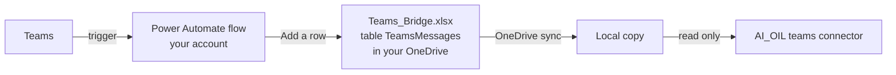

# Teams bridge and Teams connector — concept

**Status:** draft for agreement, 28 October 2026 (OP-49, steps T1–T2 of `docs/implementation_plan.md`).
**Guidance from:** the Professional-Assistant Teams bridge (its spec TM-1…TM-5 and interface checklist Block F). It is design guidance only; no code is shared.

## 1. Goal

Teams messages become a sixth source next to Outlook, Jira, Confluence, SharePoint and manual notes. You link a Teams conversation to an issue the same way you link an email conversation. Sync pulls the newest messages into the issue, with versions, and full-text search finds them.

## 2. Why a bridge

Reading Teams directly needs Microsoft Graph, which needs an app registration by IT. A Power Automate flow runs under your own account with standard connectors, needs no IT involvement, and can write each message as a row into an Excel table. The sync client then puts that Excel file on disk, where AI_OIL reads it like any other local file. This is the route the Professional-Assistant project chose for the same reason.

## 3. Constraints

| # | Constraint | Consequence |
|---|---|---|
| 1 | The flow captures nothing from before it was switched on | Older Teams discussions cannot be linked; switch the flow on as early as possible |
| 2 | Only document libraries and OneDrive are synced to disk, not SharePoint lists | The target must be an Excel table in a file, never a list |
| 3 | Power Automate writes to the online file; your laptop sees changes after the sync client catches up (normally under two minutes) | A message sent seconds ago may be missing from a sync; the next sync has it |
| 4 | Every captured message ends up in the file, including 1:1 chats if they are captured | The file must sit in **your own OneDrive**, not in a team site, so nobody else can read it |
| 5 | An Excel table that grows to tens of thousands of rows slows the flow's "Add a row" action | One file per year (`Teams_Bridge_2026.xlsx`); the connector reads all files matching the pattern |
| 6 | The exact trigger names, the fields they deliver and whether replies fire them are only visible in the flow editor of your tenant | Step T1 ends with a short check in the editor (section 7) before the connector is built |

## 4. What the flow captures

Each kind of capture is a separate small flow, so one failing flow does not stop the others.

| Flow | Trigger (Teams connector, standard) | Captures | Recommended |
|---|---|---|---|
| A — Mentions | "When I am mentioned in a channel message" and the chat variant | Every message that @-mentions you, in any chat or channel | Yes, always |
| B — Tracked channels | "When a new channel message is added", one per channel you choose | Every new post in the program's key channels | Yes, for 2–5 key channels |
| C — Tracked group chats | "When a new chat message is added", one per chat you choose | Every message in chosen group chats (e.g. a supplier escalation chat) | If you work in such chats |
| D — All 1:1 chats | — | Not proposed: high volume, mostly unrelated, private | No |

Replies inside channel threads are the open technical point: some triggers fire only for new top-level posts. Section 7 checks it; if replies are not delivered, flow B adds the reply trigger available in your tenant.

## 5. The table AI_OIL expects

File `Teams_Bridge_<year>.xlsx` in a folder of your OneDrive (proposal: `Documents\AI_OIL-Teams`), one formatted table named `TeamsMessages`, all columns text:

| # | Column | Content | Required |
|---|---|---|---|
| 1 | `MessageId` | Teams message id; unique, used for deduplication | yes |
| 2 | `ParentMessageId` | Id of the thread's first post for channel replies; empty for a top-level post or a chat message | no |
| 3 | `ConversationId` | Chat id or channel id | yes |
| 4 | `ConversationType` | `chat` or `channel` | yes |
| 5 | `ConversationName` | Chat topic, or `Team / Channel` | no |
| 6 | `Timestamp` | Message time, ISO 8601 with time zone (the flow's `createdDateTime`) | yes |
| 7 | `SenderName` | Display name | yes |
| 8 | `SenderEmail` | E-mail or UPN of the sender | no |
| 9 | `Permalink` | Link to the message in Teams | no |
| 10 | `Text` | Message body (HTML as delivered; AI_OIL converts it to text) | yes |
| 11 | `Trigger` | `Mention`, `Channel` or `Chat` (which flow wrote it) | no |

The connector reads the columns by name, so their order does not matter. It ignores unknown columns and reports missing required ones. The same message written twice (two flows fire) is stored once, by `MessageId`.

## 6. How AI_OIL uses it

| Topic | Design |
|---|---|
| Connector | `teams`, settings `folder` (the local OneDrive folder holding the bridge files), `file_pattern` (default `Teams_Bridge*.xlsx`), `table` (default `TeamsMessages`) |
| What you link | A **channel thread** (a top-level post with its replies) or a **chat from a chosen message onward** (a chat runs for months, so the link is anchored at the message you pick and includes everything after it) |
| How you link | Paste a Teams message link (Teams: "Copy link" on a message), or search captured messages by text in the link dialog, like the Outlook subject search |
| Entries | Each message is a `teams_message` entry with sender, time and text; the version text is the thread in time order |
| People | `SenderEmail` resolves to the same person as their Outlook mail; the Teams identity is stored as well (`teams`) |
| Sync | Reads the local copies only, never the network. A cloud-only placeholder file is reported (as for SharePoint, OP-7), and a OneDrive conflict copy of the bridge file is reported, not read |
| Governance | Read-only, class A. AI_OIL never posts to Teams (OP-47: no write-back) |
| Setup | A new `oil setup` stage "Teams": finds the bridge folder in OneDrive, checks the table and its columns, shows the newest captured message, and creates the connector |
| Guide | `docs/teams_bridge_setup.md`: building the flows click by click, the column mapping and the end-to-end test |

## 7. Check in the flow editor before building (end of T1)

| # | Check | Why |
|---|---|---|
| 1 | Power Automate opens with your company tenant and lets you create an automated cloud flow | Licensing or policy may block it |
| 2 | The Teams triggers from section 4 exist without a premium badge | Premium connectors need a licence |
| 3 | "Add a row into a table" (Excel Online Business) is available | Writes the row |
| 4 | Which fields the triggers deliver: message id, parent id, chat or channel id, time, sender e-mail, link, body | Decides how complete the table can be |
| 5 | Whether channel replies fire flow B | Decides whether a reply trigger is needed |
| 6 | One test message arrives in the local file within two minutes | Proves the whole chain |

## 8. Questions for you

1. **Capture scope:** flows A and B, plus C if you work in group chats. Do you agree, and which 2–5 channels and which group chats matter?
2. **File location:** your own OneDrive, folder `Documents\AI_OIL-Teams`. Agreed?
3. **Linking chats:** anchored at a chosen message and everything after it. Agreed?
