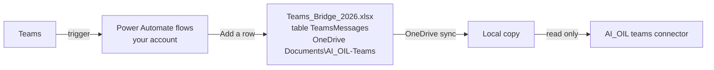

# Teams bridge and Teams connector — concept

**Status:** agreed 29 October 2026 (OP-49), to be built as steps T1–T2 of `docs/implementation_plan.md`.
**Guidance from:** the Professional-Assistant Teams bridge (its spec TM-1…TM-5 and interface checklist Block F). It is design guidance only; no code is shared.

## 1. Goal

Teams chats become a sixth source next to Outlook, Jira, Confluence, SharePoint and manual notes. You link a Teams chat to an issue the same way you link an email conversation. Sync checks every linked chat for new messages and pulls them into the issue as entries, and full-text search finds them.

## 2. Decisions (29 October 2026)

| # | Topic | Decision |
|---|---|---|
| 1 | What is captured | Every message that @-mentions you, and every chat message (1:1 and group chats). Channel posts only when they mention you |
| 2 | Where the file lives | Your own OneDrive, next to the program folder: `Documents\AI_OIL-Teams\` beside `Documents\AI_OIL\` (not inside it) |
| 3 | What you link | A whole chat or channel conversation, nothing finer. You link most of them by hand; from phase 3 the AI suggests links |
| 4 | Sync vs. scan | Sync only updates what is linked. Looking through everything (the whole mailbox, all captured Teams chats) for new topics is a **separate** action, "Scan for new topics" (phase 3). Its proposals carry their source: accepting a new-issue proposal creates the issue with the email or chat linked; a link proposal links the conversation to an existing issue |

## 3. Why a bridge

Reading Teams directly needs Microsoft Graph, which needs an app registration by IT. A Power Automate flow runs under your own account with standard connectors, needs no IT involvement, and can write each message as a row into an Excel table. OneDrive then puts that Excel file on disk, where AI_OIL reads it like any other local file.

## 4. Constraints

| # | Constraint | Consequence |
|---|---|---|
| 1 | The flows capture nothing from before they were switched on | Older Teams discussions cannot be linked; switch the flows on as early as possible |
| 2 | Only document libraries and OneDrive are synced to disk, not SharePoint lists | The target is an Excel table in a file, never a list |
| 3 | Power Automate writes to the online file; the laptop sees changes after OneDrive catches up (normally under two minutes) | A message sent seconds ago may be missing from a sync; the next sync has it |
| 4 | All your chats end up in the file | It sits in your own OneDrive, which nobody else can read |
| 5 | An Excel table with tens of thousands of rows slows the flow's "Add a row" action | One file per year (`Teams_Bridge_2026.xlsx`, `Teams_Bridge_2027.xlsx`); AI_OIL reads every file matching `Teams_Bridge*.xlsx` |
| 6 | Channel posts that do not mention you are not captured | A linked channel conversation shows only the posts that mention you; chats are complete |
| 7 | The exact trigger names and fields are only visible in your tenant's flow editor | `docs/teams_bridge_setup.md` starts with a short check; if "any chat" is not offered by the chat trigger, we decide together before going on |

## 5. The two flows

| Flow | Trigger (Teams connector, standard) | Captures |
|---|---|---|
| A — Mentions | "When I am @mentioned" (chats and channels) | Every message that mentions you |
| B — Chats | "When a new chat message is added", for any chat | Every message in your 1:1 and group chats |

A message that both mentions you and sits in a chat is written twice; AI_OIL stores it once.

## 6. The table AI_OIL expects

File `Teams_Bridge_<year>.xlsx` in `Documents\AI_OIL-Teams\`, one formatted table named `TeamsMessages`, all columns text:

| # | Column | Content | Required |
|---|---|---|---|
| 1 | `MessageId` | Teams message id; unique, used for deduplication | yes |
| 2 | `ConversationId` | Chat id, or channel id plus thread for channel posts | yes |
| 3 | `ConversationType` | `chat` or `channel` | yes |
| 4 | `ConversationName` | Chat topic or channel name, as far as the trigger delivers it | no |
| 5 | `Timestamp` | Message time, ISO 8601 with time zone | yes |
| 6 | `SenderName` | Display name | yes |
| 7 | `SenderEmail` | E-mail or UPN of the sender | no |
| 8 | `Permalink` | Link to the message in Teams | no |
| 9 | `Text` | Message body (HTML as delivered; AI_OIL converts it to text) | yes |
| 10 | `Trigger` | `Mention` or `Chat` (which flow wrote it) | no |

AI_OIL reads the columns by name, so their order does not matter; it ignores extra columns and reports missing required ones.

## 7. How AI_OIL uses it

| Topic | Design |
|---|---|
| Connector | `teams`, settings `folder` (the local `AI_OIL-Teams` folder), `file_pattern` (default `Teams_Bridge*.xlsx`), `table` (default `TeamsMessages`) |
| Source object | `teams_thread` = one conversation (`ConversationId`); entries are its messages (`teams_message`), as for email conversations; there is no separate version text |
| Linking | Paste a Teams message link (Teams: "Copy link" on any message in the chat), or search captured chats by name, participant or text in the link dialog, like the Outlook subject search |
| People | `SenderEmail` resolves to the same person as their Outlook mail; the Teams identity is stored as well (`teams`) |
| Sync | Reads the local copies only, never the network. A cloud-only placeholder or a OneDrive conflict copy of a bridge file is reported, not read |
| Scan for new topics | Phase 3: unlinked captured chats are one input of the separate scan (decision 4), next to the mailbox scan (CON-26) and Jira |
| Governance | Read-only, class A. AI_OIL never posts to Teams (OP-47) |
| Setup | A new `oil setup` stage "Teams": finds `AI_OIL-Teams` in OneDrive, checks the table and its columns, shows the newest captured message, creates the connector |
